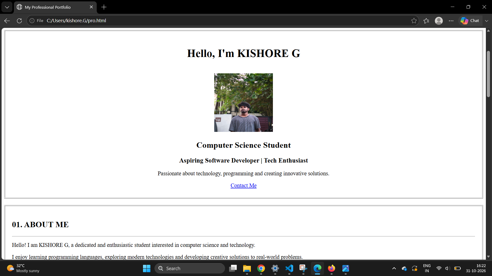

# Ex01 Portfolio
## Date:

## AIM
To create a Portfolio using HTML and CSS.

## ALGORITHM
### STEP 1
Create an HTML file (index.html)

### STEP 2
Create a CSS file (style.css)

### STEP 3
Include a navigation bar with links to different sections.

### STEP 4
Add structured sections for introduction, about, projects, and contact details.

### STEP 5
Define global styles for fonts, colors, and layout.

### STEP 6
Style the header, navigation bar, and sections.

### STEP 7
Use Flexbox or CSS Grid for layout design.

### STEP 8
Add hover effects and transitions for interactivity.

### STEP 9
Add Images and Media.

### STEP 10
Use optimized images for a professional look.

### STEP 11
Open the HTML file in a browser to check layout and functionality.

### STEP 12
Fix styling issues and refine content placement.

### STEP 13
Deploy the Portfolio.

### STEP 14
Upload to GitHub Pages for free hosting.

## PROGRAM
```

<!DOCTYPE html>
<html>
<head>
    <title>My Professional Portfolio</title>
</head>

<body>

    <!-- HEADER -->
    <table width="100%" cellpadding="20" border="1">
        <tr>
            <td align="center">
                <h1>MY PORTFOLIO</h1>
                <h3>Personal Website | Professional Profile</h3>
            </td>
        </tr>
    </table>

    <br>

    <!-- NAVIGATION -->
    <table width="100%" cellpadding="12" border="1">
        <tr align="center">
            <td><a href="#home">HOME</a></td>
            <td><a href="#about">ABOUT</a></td>
            <td><a href="#education">EDUCATION</a></td>
            <td><a href="#skills">SKILLS</a></td>
            <td><a href="#projects">PROJECTS</a></td>
            <td><a href="#contact">CONTACT</a></td>
        </tr>
    </table>

    <br>

    <!-- HOME -->
    <table width="100%" cellpadding="25" border="1">
        <tr>
            <td align="center">
                <h1>Hello, I'm KISHORE G</h1>

                <br>

                

                <h2>Computer Science Student</h2>

                <h3>Aspiring Software Developer | Tech Enthusiast</h3>

                <p>
                    Passionate about technology, programming
                    and creating innovative solutions.
                </p>

                <a href="#contact">Contact Me</a>
            </td>
        </tr>
    </table>

    <br>

    <!-- ABOUT -->
    <table width="100%" cellpadding="20" border="1">
        <tr>
            <td>
                <h2>01. ABOUT ME</h2>
                <hr>

                <p>
                    Hello! I am KISHORE G, a dedicated and
                    enthusiastic student interested in computer
                    science and technology.
                </p>

                <p>
                    I enjoy learning programming languages,
                    exploring modern technologies and developing
                    creative solutions to real-world problems.
                </p>
            </td>
        </tr>
    </table>

    <br>

    <!-- EDUCATION -->
    <table width="100%" cellpadding="20" border="1">
        <tr>
            <td>
                <h2>02. EDUCATION</h2>
                <hr>

                <table border="1" width="100%" cellpadding="12">
                    <tr>
                        <th>Qualification</th>
                        <th>Institution</th>
                        <th>Year</th>
                    </tr>

                    <tr>
                        <td>B.E. Computer Science</td>
                        <td>SAVEETHA ENGINEERING COLLEGE</td>
                        <td>2025 - 2029</td>
                    </tr>

                    <tr>
                        <td>SSLC</td>
                        <td>Your School Name</td>
                        <td>2023</td>
                    </tr>
                </table>
            </td>
        </tr>
    </table>

    <br>

    <!-- SKILLS -->
    <table width="100%" cellpadding="20" border="1">
        <tr>
            <td>
                <h2>03. TECHNICAL SKILLS</h2>
                <hr>

                <h3>Programming Languages</h3>
                <ul>
                    <li>Python</li>
                    <li>C Programming</li>
                    <li>Java</li>
                </ul>

                <h3>Web Technologies</h3>
                <ul>
                    <li>HTML</li>
                    <li>Web Development</li>
                </ul>

                <h3>Professional Skills</h3>
                <ul>
                    <li>Problem Solving</li>
                    <li>Teamwork</li>
                    <li>Communication</li>
                    <li>Time Management</li>
                </ul>
            </td>
        </tr>
    </table>

    <br>

    <!-- PROJECTS -->
    <table width="100%" cellpadding="20" border="1">
        <tr>
            <td>
                <h2>04. MY PROJECTS</h2>
                <hr>

                <h3>Project 01 - Portfolio Website</h3>
                <p>Created a personal website using HTML.</p>

                <h3>Project 02 - Student Management System</h3>
                <p>A system to organize student information.</p>

                <h3>Project 03 - Online Calculator</h3>
                <p>A basic calculator for mathematical operations.</p>
            </td>
        </tr>
    </table>

    <br>

    <!-- ACHIEVEMENTS -->
    <table width="100%" cellpadding="20" border="1">
        <tr>
            <td>
                <h2>05. ACHIEVEMENTS</h2>
                <hr>

                <ul>
                    <li>Completed Programming Courses</li>
                    <li>Participated in Technical Events</li>
                    <li>Attended College Workshops</li>
                    <li>Completed Online Certifications</li>
                </ul>
            </td>
        </tr>
    </table>

    <br>

    <!-- CONTACT -->
    <table width="100%" cellpadding="20" border="1">
        <tr>
            <td>
                <h2>06. CONTACT ME</h2>
                <hr>

                <p><b>Email:</b> yourname@gmail.com</p>
                <p><b>Phone:</b> +91 9876543210</p>
                <p><b>Location:</b> Chennai, Tamil Nadu</p>

                <p>
                    <b>LinkedIn:</b>
                    <a href="https://www.linkedin.com/">
                        Visit My Profile
                    </a>
                </p>

                <p>
                    <b>GitHub:</b>
                    <a href="https://github.com/">
                        Visit My GitHub
                    </a>
                </p>

                <h3>Send Me a Message</h3>

                <form>
                    <label>Your Name:</label><br>
                    <input type="text" placeholder="Enter your name">
                    <br><br>

                    <label>Your Email:</label><br>
                    <input type="email" placeholder="Enter your email">
                    <br><br>

                    <label>Message:</label><br>
                    <textarea rows="5" cols="40"
                    placeholder="Write your message"></textarea>
                    <br><br>

                    <input type="submit" value="Send Message">
                </form>
            </td>
        </tr>
    </table>

    <br>

    <!-- FOOTER -->
    <table width="100%" cellpadding="20" border="1">
        <tr>
            <td align="center">
                <h3>THANK YOU FOR VISITING MY PORTFOLIO!</h3>

                <p>"Learning Today, Leading Tomorrow."</p>

                <p>Copyright &copy; 2026 KISHORE G</p>
            </td>
        </tr>
    </table>

</body>
</html>
```

## OUTPUT



## RESULT
The program for creating Portfolio using HTML and CSS is executed successfully.
